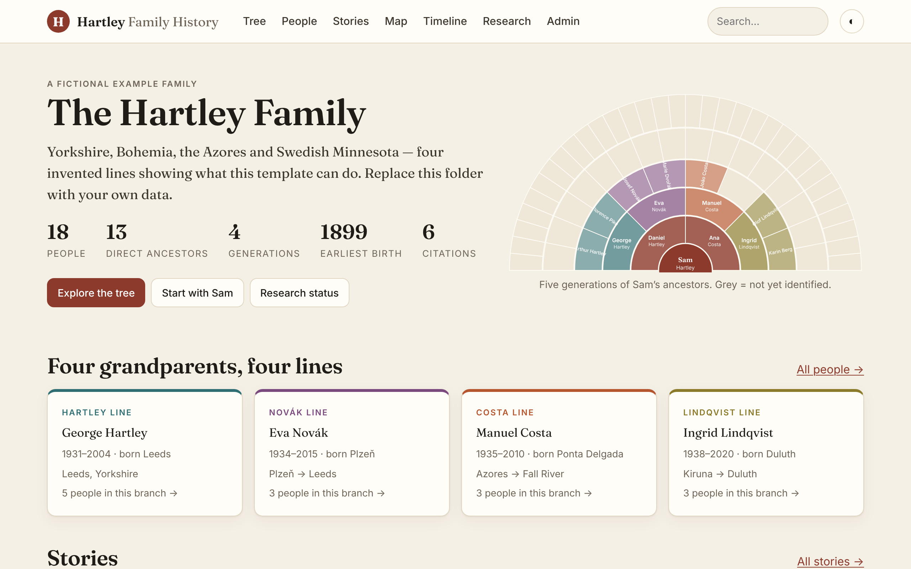
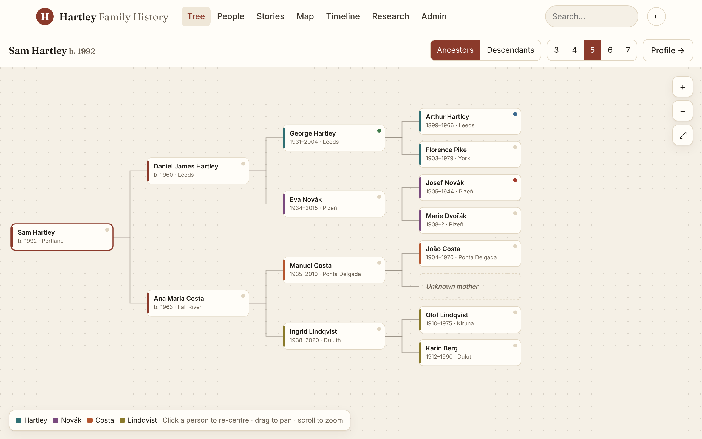
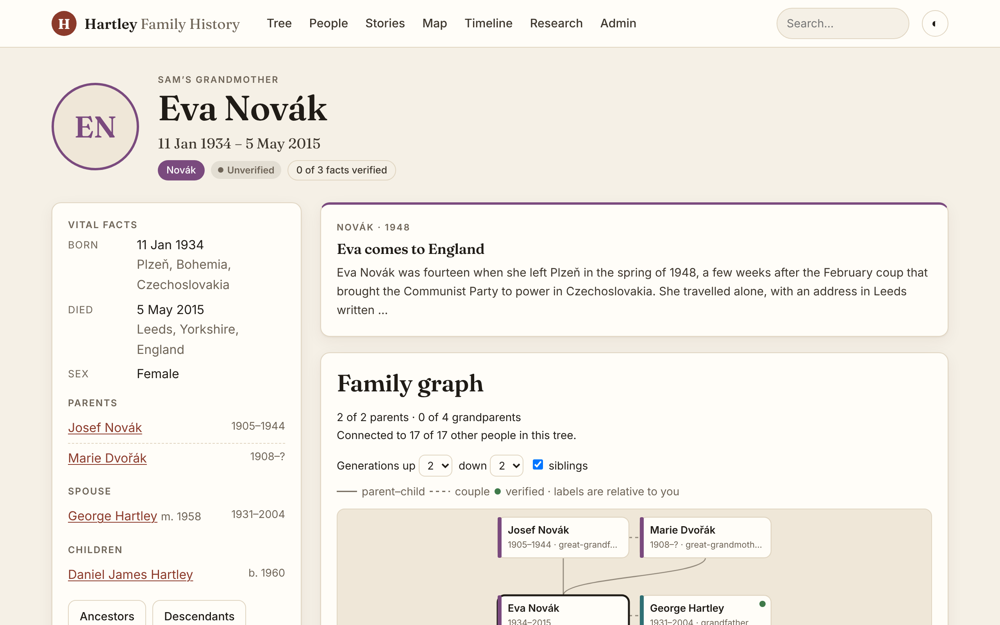
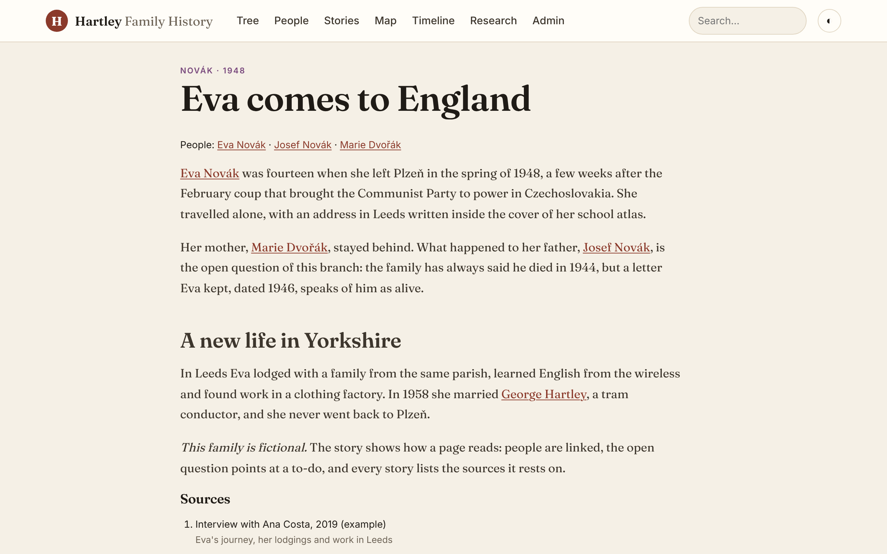
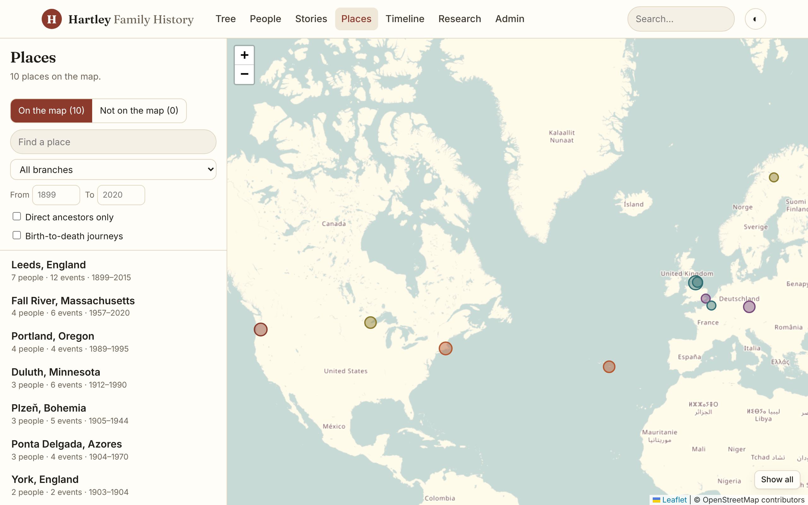
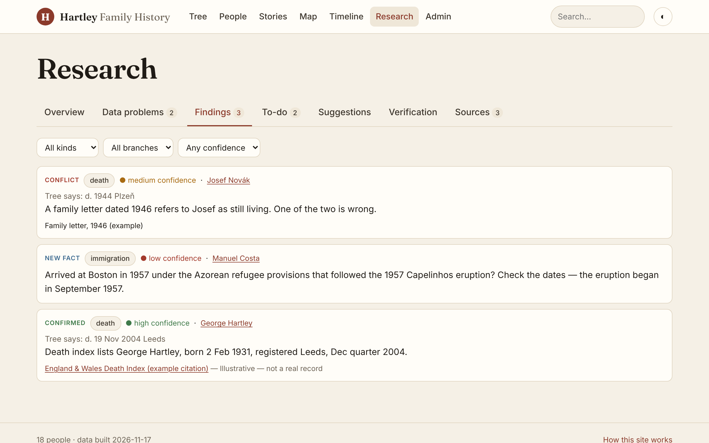
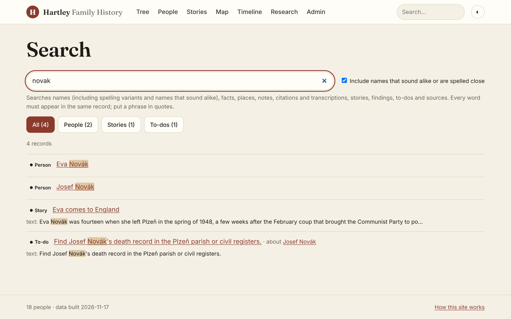
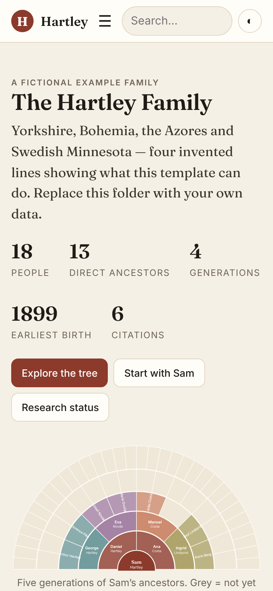
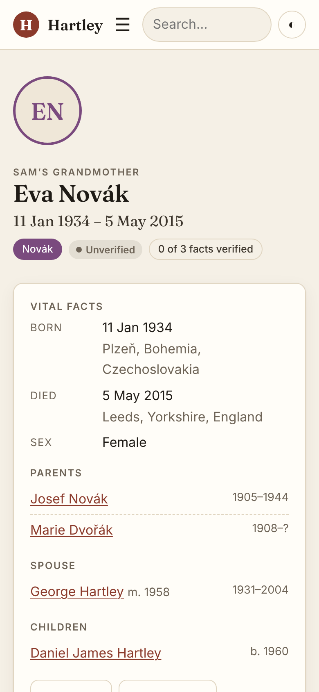

# Family Tree

**A private family-history site that runs on your own Cloudflare account.** Bring a GEDCOM export from Ancestry, Gramps, MyHeritage or FamilySearch. You get an interactive tree, a page for every person, stories, a map, and a research workflow that tracks what's actually been proven, all visible only to the relatives you invite.

[](https://deploy.workers.cloudflare.com/?url=https://github.com/awbauer/family-tree)

<picture>
  <source media="(prefers-color-scheme: dark)" srcset="docs/screenshots/home-dark.png">
  
</picture>

<sub>Every screenshot shows the fictional example family in [`example/`](example). No real people appear in this repository.</sub>

## What you get

- **Explore the family.** A tree page with four views (chart, family graph, fan or sunburst, and a numbered outline that reads well on a phone), a page per person with a life timeline and footnoted sources, plus stories, a places map (a page per place with who was there, what happened and the photos and documents that show or name it, and a small map on each person's page), and a timeline set against history.
- **Research you can trust.** Every person is *verified*, *partly verified*, *unverified* or *disputed*. Findings carry their sources and a confidence level, and searches that found nothing are logged too. Automatic checks catch duplicates, people with two sets of parents, impossible ages, misfiled Ancestry events and anachronistic places.
- **Edit together, safely.** Editors change the tree in the app. Every change records who, why and its sources, and can be undone. Relatives without edit rights suggest changes for review. Each relative gets a *view*, which decides how much of living people they see (full, names only, anonymous or hidden).
- **Search built for genealogy.** Search every name, fact, note, citation and story. Name matching handles spelling variants and sound-alikes (Daitch–Mokotoff Soundex), which helps with Central and Eastern European names.
- **AI that helps without inventing.** There are optional research agents, a page assistant, and an MCP server so relatives can use the tree from their own AI clients. They work through the same permissions as people do, and their work goes to review rather than straight into the tree.
- **Your data stays yours.** It lives in your D1 database and R2 bucket. You can export it as GEDCOM 5.5.1, GEDCOM X or JSON at any time.

## A closer look

| | |
|---|---|
|  |  |
| **Tree.** Pan, zoom and re-centre on anyone; colours follow the four grandparent lines. | **Person.** Facts, family, story links, a family graph, then life events, research and sources. |
|  |  |
| **Stories.** Narratives that link people and list the sources they rest on. | **Places.** Every place on one map, filtered by branch and years, each with its own page of people, events, photos and documents. |
|  |  |
| **Research.** Findings, data problems, to-dos, suggestions and verification in one place. | **Search.** Across everything you can see, with matches highlighted. |

<p align="center">
  
  &nbsp;&nbsp;
  
</p>

## Try it locally (two minutes)

You need **Node 26** (25 or later works) and **Python 3.9+**. No Cloudflare account is needed.

```sh
git clone https://github.com/awbauer/family-tree && cd family-tree
npm install
npm run build:web
npm run dev:example          # http://localhost:8790, the real Worker on the fictional family, signed in as the owner
```

## Deploy to Cloudflare

### One click

The **Deploy to Cloudflare** button above:

- copies this repository into your GitHub or GitLab account;
- creates the D1 database, the R2 bucket and the Durable Objects for the agents;
- builds the site and deploys the Worker;
- connects your copy to Workers Builds, so every push to your copy redeploys and applies new database migrations (`npm run deploy`).

The site starts **locked**. Until Cloudflare Access is set up, the Worker refuses to serve any family data, and it has no public `workers.dev` URL. Then do this once:

1. **Give it a hostname.** In Workers & Pages → *family-tree* (or the name you chose) → Settings → Domains & Routes, add a custom domain such as `family.example.com`. The domain must be on Cloudflare.
2. **Turn on Access.** In Workers & Pages → *family-tree* → **Access**, add a policy that allows your family's email addresses. Copy the application's **AUD tag**. (A self-hosted Access application for the hostname also works: see [Which Access setup](docs/agents/operations.md#deployment-considerations-how-the-worker-checks-access).)
3. **Tell the Worker.** In Settings → Variables and Secrets, add three text variables:
   - `ACCESS_TEAM_DOMAIN`: your team domain, `<team>.cloudflareaccess.com`
   - `ACCESS_AUD`: the AUD tag
   - `OWNER_EMAIL`: your email address

   Deploys keep these, because `keep_vars` is on.
4. **Load your tree** (below), then open your hostname and sign in.

### Load your tree

Run the import once from your own copy of the repo. Afterwards the app is the source of truth: you edit there, and changes from a later Ancestry export arrive as suggestions (`tools/import_hints.py`).

```sh
git clone <your copy> && cd family-tree && npm install
npx wrangler login
cp wrangler.jsonc wrangler.local.jsonc          # your copy already has your database id; npm scripts read this file
mkdir family-data                               # git-ignored: your private data lives here
cp example/research.json example/places.json family-data/
# put your .ged export in family-data/, then edit research.json: site title, home_person (your GEDCOM id), branches
python3 tools/build.py --raw-out build/raw.json # prints counts, unmatched places and data problems
python3 tools/seed_app.py --owner you@example.com --cutover
npm run db:import                               # loads into D1; refuses once the app owns the data
```

The file formats are in [docs/data-format.md](docs/data-format.md). Photos go in the R2 bucket; see [Photos](docs/agents/operations.md#photos-r2).

### By hand

Prefer the command line, or want to deploy from the original repository? [docs/agents/operations.md](docs/agents/operations.md) covers manual setup with `wrangler.local.jsonc`, automatic deploys with Workers Builds, migrations, invites, backups and restore.

### What it costs

A family-sized tree fits comfortably within Cloudflare's free allowances for Workers, D1 and R2. The AI features are optional and run on Workers AI, billed to your account; some of the default models need the Workers Paid plan. Model choices and prices are in [docs/agents/models.md](docs/agents/models.md).

## How it fits together

```
 browser ──▶ Cloudflare Access ──▶ Worker (worker/)
                 (who you are)        ├─ site: React app (web/ → dist/site), static, holds no data
                                      ├─ /api, /media, /mcp: checks the Access token itself, then your grants
                                      ├─ D1: the tree, research, edit history      (migrations/)
                                      ├─ R2: photos, documents, reports
                                      └─ Durable Objects + Workers AI: the agents  (agents/)
```

- **Fails closed.** The Worker verifies the Access JWT itself (signature, audience, issuer, expiry), so a missing or misconfigured Access policy publishes nothing. Without `ACCESS_TEAM_DOMAIN` and `ACCESS_AUD`, every data request gets a 403.
- **Per-person permissions.** Owners see everything. Everyone else needs a grant to a tree, as an editor, member or agent, with a view that decides how much of living people they see.
- **Private by design.** Living relatives' details never leave your account. This repository holds code and a fictional family only, and a pre-commit hook (`tools/check_privacy.py`) blocks private data from being committed.

## Documentation

| | |
|---|---|
| [docs/agents/operations.md](docs/agents/operations.md) | Setup, deploys, Access, invites, migrations, photos, export, restore |
| [docs/data-format.md](docs/data-format.md) | `research.json` and `places.json` |
| [docs/agents/research-protocol.md](docs/agents/research-protocol.md) | How research is done, weighed, cited and recorded |
| [docs/agents/models.md](docs/agents/models.md) | Which AI model each agent uses, and why |
| [docs/design/](docs/design) | Data model and standards (GEDCOM X), edit operations, source of truth |
| [AGENTS.md](AGENTS.md) | Rules for AI coding and research agents working in this repo |

## Working on the code

```sh
npm run dev:example     # the Worker on the fictional family (port 8790)
npm run dev:web         # Vite with hot reload on http://localhost:5173, proxying /api to the line above
npm test                # unit tests (also: npm run test:gedcomx, npm run eval:agents)
npm run typecheck
npm run test:e2e        # every page in a real browser (Playwright)
npm run screenshots     # regenerate docs/screenshots from the example family
```

- The site is React and TypeScript in `web/src`. The Worker is plain ES modules in `worker/`. The Python tools in `tools/` use only the standard library.
- All user-facing text lives in `strings/` (`npm run check:strings`).
- Test against the fictional family in `example/`, never against real data. [AGENTS.md](AGENTS.md) has the full conventions.
- `npm install` turns on git hooks that block private data from commits. Don't bypass them.

## License

[MIT](LICENSE)
